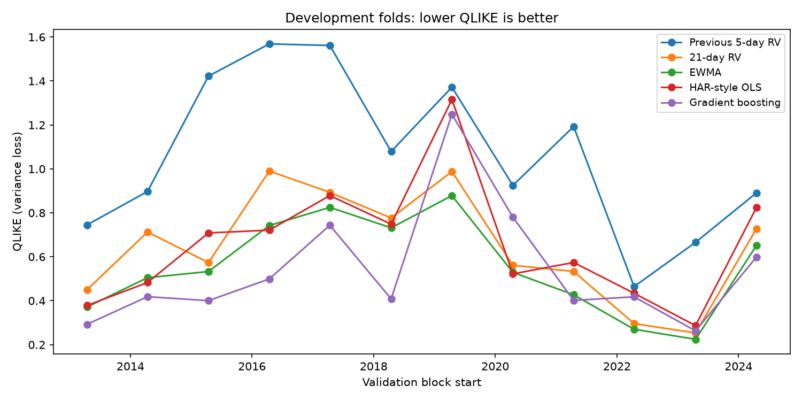
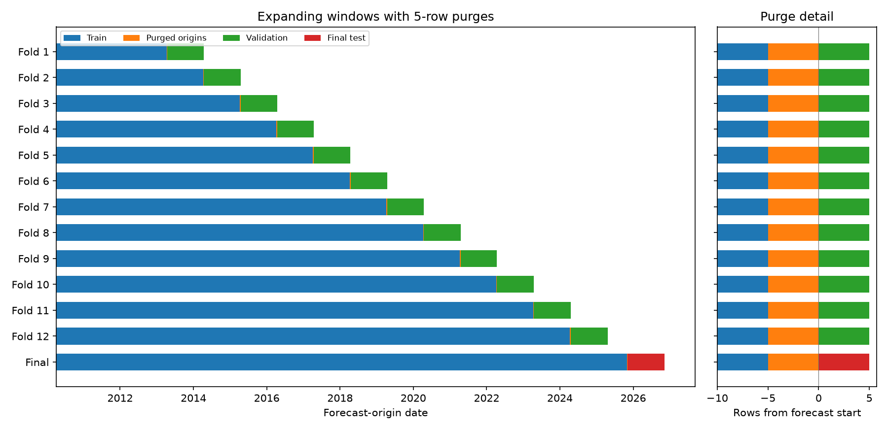

# Walk-Forward Volatility Forecaster

Can information available at each daily close forecast SPY's next-week realised volatility better than a recent-volatility baseline?

Across 12 development folds, gradient boosting had lower QLIKE than EWMA in 8 of them. On the final year it scored 0.404929 against EWMA's 0.463336. The point estimates favour ML, while losing folds and a DM p-value of 0.224942 leave weak evidence for a dependable gain.

## Final test

Forecast origins: **2025-11-07 to 2026-11-09**, with 252 complete five-day targets. Final labels end 2026-11-16. Lower scores are better; a volatility error of 0.01 is one percentage point.

| Model | QLIKE | RMSE (points) | MAE (points) |
| --- | ---: | ---: | ---: |
| Previous 5-day RV | 0.838669 | 6.7868 | 4.8033 |
| 21-day RV | 0.517881 | 6.3519 | 4.6511 |
| EWMA | 0.463336 | 6.0474 | 4.4233 |
| HAR-style OLS | 0.542763 | 5.9556 | 4.0665 |
| Gradient boosting | 0.404929 | 5.2868 | 3.5731 |

Source: [metrics.json](reports/metrics.json). The DM comparator was chosen by development mean QLIKE, before final evaluation. [Forecasts](reports/test_predictions.csv), [regime errors](reports/figures/error_by_regime.png) and [the full test plot](reports/figures/realised_vs_predicted_test.png) are included.

## Development and splits



All models use identical rows. The [per-fold table](reports/fold_scores.csv) includes dates, sample sizes and each score. ML parameters were selected on these folds, so its development scores benefit from selection. [Every grid result](reports/grid_scores.csv) is retained.



## What is forecast

For adjusted close $P_t$, daily return is $r_t = \ln(P_t/P_{t-1})$. At the close of day $t$, the target is:

$$
RV_{t+1:t+5} = \sqrt{\frac{252}{5}\sum_{i=1}^{5}r_{t+i}^{2}}
$$

Take the next five daily returns, square them, average, annualise and take the square root. Five returns need six closing prices. Every trailing RV uses the same zero-mean convention.

Leakage checks cover:

- Past-only features: truncating the series leaves earlier features unchanged.
- Purged labels: training targets end before validation and test forecast origins.
- Frozen choices: QLIKE, features and the grid are fixed before the final test.

See the [tests](tests/) and [design](docs/design.md). The baselines are previous-five-day RV, 21-day RV, fixed-decay EWMA and HAR-style OLS. HAR and boosting fit log volatility; predictions are exponentiated.

## Run it

Python 3.12 is the tested version. From the repository root:

```sh
python -m venv .venv
# Linux/macOS: source .venv/bin/activate
# PowerShell: .venv\Scripts\Activate.ps1
python -m pip install -r requirements.txt
python -m src.fetch_data
python -m src.reproduce
```

With Make, the equivalent commands are `make setup fetch reproduce`. Run checks with `make lint test`, or `python -m ruff check .`, `python -m ruff format --check .` and `python -m pytest`. Tests use simulated prices and need no network or Yahoo file.

Reproduction refits frozen choices and checks the saved fold scores, final metrics and forecasts. It does not retune or overwrite the published experiment. The [data record](data/README.md) explains the fixed snapshot and revised-download handling.

## Limits

This is not investment advice, a trading strategy or a profitability claim. Only SPY and daily data are studied. The final 252 daily observations contain about 50 non-overlapping weeks, so one test year is weak evidence. Yahoo history can be revised, and the DM approximation has limited power here. Read the [limitations](docs/limitations.md).

## Repository map

- `src/`: fetch, features, target, split, models and experiment commands
- `tests/`: causal feature checks, hand calculations and end-to-end verification
- `reports/`: frozen choices, fold tables, final forecasts and plots
- `docs/`: [design](docs/design.md), [decisions](docs/decisions.md), [CV and website wording](docs/portfolio.md)
